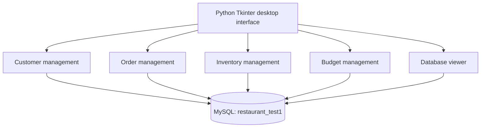
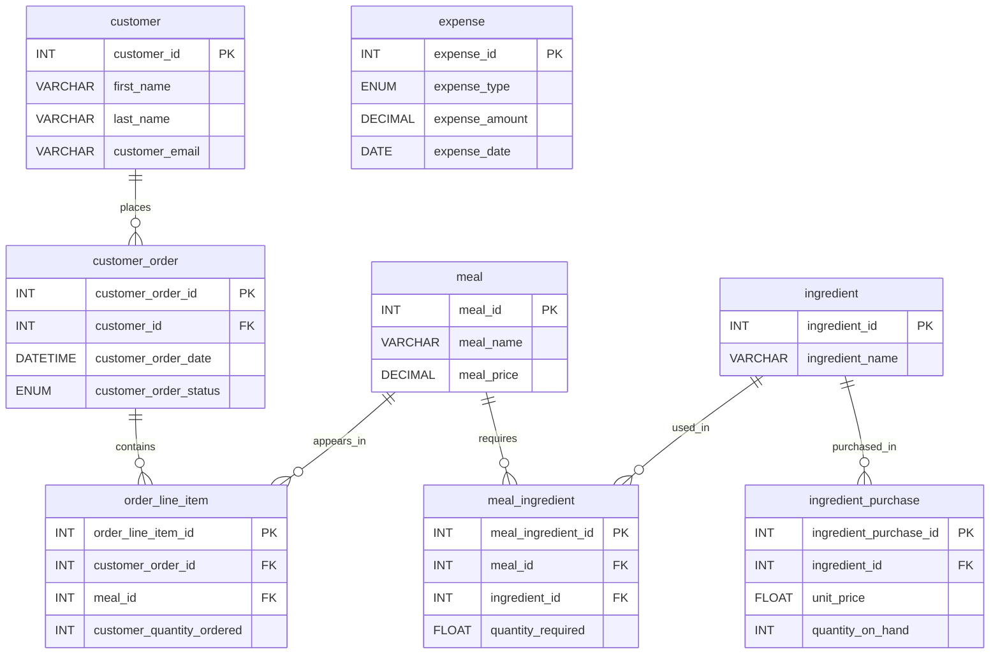

# Intelligent Restaurant Management System

**MGIS320 · Team 5 — Nexolutions | Academic Team Project**

A Python desktop application backed by a MySQL relational database, designed to support day-to-day restaurant operations—from customer orders and ingredient inventory to expenses, reports, and database records.

**Tech stack:** `Python` · `Tkinter` · `MySQL` · `SQL` · `mysql-connector-python` · `PyMySQL` · `Matplotlib` · `NumPy` · `Pillow` · `tkcalendar`

> **Team attribution:** This is a collaborative course project developed by **MGIS320 Team 5 — Nexolutions**. **Xiangyu Guo** was responsible for the complete database development and contributed to selected Python components. The remaining application work was completed collaboratively by the team. This repository should not be interpreted as a solo development project.

## Table of Contents

- [Project Overview](#project-overview)
- [Core Features](#core-features)
- [System Architecture](#system-architecture)
- [Database Design](#database-design)
- [Repository Structure](#repository-structure)
- [Getting Started](#getting-started)
- [My Contributions](#my-contributions)
- [Project Status and Limitations](#project-status-and-limitations)
- [Acknowledgements and Usage](#acknowledgements-and-usage)

## Project Overview

Restaurant operations involve multiple connected workflows: registering customers, creating orders, checking ingredient availability, monitoring stock purchases, and reviewing financial activity. This project brings those workflows into a desktop interface with a shared relational database.

The system uses **Tkinter** for its graphical user interface and **MySQL** for storing operational data. Separate Python modules provide customer management, order tracking, inventory management, budgeting, and a database viewer. The application is designed as an **academic prototype**, not a production-ready service.

## Core Features

| Module | Implemented functionality | Source file |
| --- | --- | --- |
| Welcome & login | Restaurant welcome page, demo login, role-based module navigation | `AAAlog_in.py` |
| Customer management | Display customer information, add/edit customers, view associated orders | `customer_manage.py` |
| Order management | Create orders, check available inventory, update order status, generate reports, export report data | `order_manage.py` |
| Inventory management | View ingredient stock, inventory records, cost-related data, add/edit inventory entries | `inventory_manage.py` |
| Budget management | Review income, variable costs, fixed expenses, and visual summaries | `budget_manage.py` |
| Database viewer | Browse customer, inventory, order, and budget records | `show_database.py` |

The login interface offers **Admin**, **Server**, **Manager**, and **Accountant** navigation options. These options determine which module buttons appear in the demo interface; they are **not** a production-grade authorization mechanism.

## System Architecture



The desktop modules use `mysql-connector-python` and/or `PyMySQL` to query and update a local MySQL database. Budget and inventory interfaces also use Matplotlib for charting.

## Database Design

**Database name:** `restaurant_test1`  
**Schema file:** [`database_schema.sql`](database_schema.sql)  
**Number of tables:** **8**

### Tables and responsibilities

| Table | Purpose | Key relationships |
| --- | --- | --- |
| `customer` | Customer contact and registration information | Referenced by `customer_order` |
| `meal` | Menu items, prices, and descriptions | Referenced by `order_line_item` and `meal_ingredient` |
| `ingredient` | Ingredient master data | Referenced by `meal_ingredient` and `ingredient_purchase` |
| `customer_order` | Order dates, delivery details, and status | Foreign key to `customer` |
| `order_line_item` | Meals, quantities, and recorded prices for each order | Foreign keys to `customer_order` and `meal` |
| `meal_ingredient` | Ingredients and quantities required for each meal | Foreign keys to `meal` and `ingredient` |
| `ingredient_purchase` | Stock quantity, unit price, purchase date, and expiration date | Foreign key to `ingredient` |
| `expense` | Expenses by type, amount, and date | Standalone table |

### Entity–relationship diagram

The following diagram represents the foreign-key relationships defined in the supplied SQL schema.



### Data integrity and sample data

The schema defines **primary keys**, **foreign keys**, required fields, and selected constraints such as unique customer email addresses and enumerated order/expense statuses. For example, order status is limited in the SQL schema to `pending`, `processing`, `completed`, and `cancelled`.

`database_schema.sql` creates the database and tables and inserts **illustrative demonstration data** for customers, meals, ingredients, inventory purchases, expenses, and orders. The data is included for coursework and testing; it is not intended to represent live restaurant records.

## Repository Structure

```text
restaurant-management-system/
├── AAAlog_in.py             # Welcome page, login and module navigation
├── customer_manage.py       # Customer management
├── order_manage.py          # Order entry, tracking and reporting
├── inventory_manage.py      # Ingredient inventory management
├── budget_manage.py         # Income, costs and budget reporting
├── show_database.py         # Database record viewer
├── database_schema.sql      # MySQL schema and sample data
├── requirements.txt         # Python package dependencies
├── .env.example             # Local configuration variable examples
├── .gitignore               # Excluded local/sensitive files
├── *.png / *.ico            # Application images and icons
└── README.md
```

## Getting Started

### Prerequisites

- **Python 3** with Tkinter support
- **MySQL Server** running locally
- A Terminal and a local Python virtual environment (recommended)
- The project files from this repository

### 1. Download the repository

Clone the repository with Git, or use **Code → Download ZIP** on GitHub and extract it. Open Terminal in the folder containing `AAAlog_in.py`.

### 2. Install Python dependencies

On macOS:

```bash
python3 -m venv .venv
source .venv/bin/activate
python3 -m pip install -r requirements.txt
```

> Tkinter is part of many Python installations but may need to be installed or enabled separately, depending on your Python distribution.

### 3. Initialize the MySQL database

Ensure your MySQL server is running, then import the provided SQL script:

```bash
mysql -u root -p < database_schema.sql
```

Enter your **local MySQL password** when prompted. The script creates and selects `restaurant_test1`, creates eight tables, and inserts sample records. **Use a disposable local database:** the SQL is intended for initial setup and is not designed as a safe repeatable migration.

### 4. Configure local demo credentials

The publication-ready version reads its application login password from the `APP_LOGIN_PASSWORD` environment variable. The other modules may read `MYSQL_PASSWORD` as a fallback when launched independently.

Set both variables in the Terminal session where you will start the application:

```bash
export APP_LOGIN_PASSWORD='YOUR_DEMO_APP_PASSWORD'
export MYSQL_PASSWORD='YOUR_LOCAL_MYSQL_PASSWORD'
```

The `.env.example` file documents these variable names; **the app does not automatically load `.env.example`**. Do not commit real credentials or a populated `.env` file.

### 5. Launch the application

```bash
python3 AAAlog_in.py
```

Select a demo role and enter:

1. The **application password** configured through `APP_LOGIN_PASSWORD`.
2. Your **local MySQL password** in the separate MySQL password field.

After successful login, use the visible module buttons to open the relevant management tools. The application expects MySQL to be accessible at `localhost` with the `root` user and the `restaurant_test1` database unless the Python code is adapted.

## My Contributions

**Xiangyu Guo — Database Developer & Python Development Contributor**

As a member of **MGIS320 Team 5 — Nexolutions**, I took ownership of the **entire database development** and contributed to **part of the Python application code**.

### Database development — primary responsibility

- Designed and implemented the complete **MySQL relational database**, covering eight interconnected tables for customers, meals, orders, ingredients, purchases, and expenses.
- Created the schema in SQL, including **primary and foreign keys**, column types, required-field rules, and other data-integrity constraints.
- Modeled key relationships between customers and orders, orders and meals, and meals and ingredients using relational and junction tables.
- Prepared SQL scripts for **database creation and initialization**, including demonstration records to support module testing and data exploration.

### Python development — collaborative contribution

- Contributed Python code to selected parts of the desktop application.
- Collaborated on connecting application workflows to the underlying MySQL database and supporting system integration.

> The other team members' work is acknowledged as part of the shared project. This section describes my own responsibilities and does not claim sole authorship of the application.

## Project Status and Limitations

- **Academic prototype:** Intended for educational demonstration and portfolio documentation, not live restaurant operations.
- **Authentication and permissions:** The simplified application password and role-based menu visibility should not be treated as secure user authentication or authorization.
- **Database access:** The provided code uses local MySQL connections and, in the current demo, the `root` database user. A production system should use least-privilege accounts and safer credential handling.
- **Credential handling:** Some modules receive the database password via command-line arguments. This should be refactored before any real deployment.
- **Testing:** The publication-ready Python files were syntax-checked, but a full end-to-end test with a live MySQL server has **not** been completed.
- **Screenshots:** The repository includes application artwork, but verified screenshots of the running desktop modules have not yet been added.

## Acknowledgements and Usage

Developed collaboratively by **MGIS320 Team 5 — Nexolutions**. Thanks to all team members for their work on the restaurant management application.

This repository is shared for **academic and portfolio presentation**, subject to agreement from the project's contributors. **No open-source license has been granted here**; do not assume the code or assets are licensed for unrestricted reuse. Confirm team permission before making the repository public.
